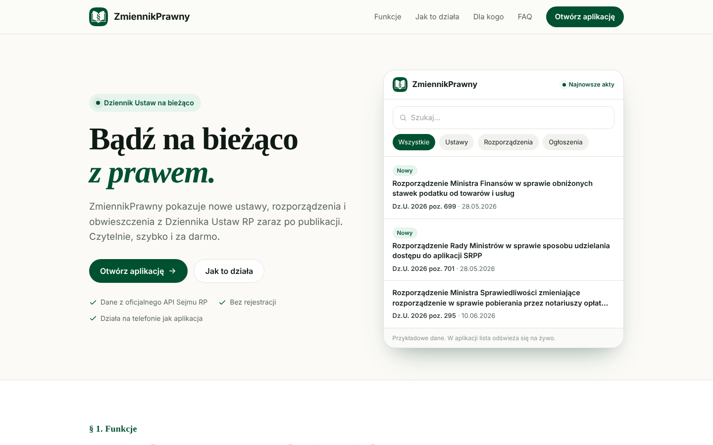

<p align="center">
  
</p>

<h1 align="center">zmiennikprawny.pl</h1>

<p align="center">
  Strona główna <b>ZmiennikPrawnego</b> – aplikacji do śledzenia nowych aktów prawnych z Dziennika Ustaw RP.
</p>

<p align="center">
  <a href="https://zmiennikprawny.pl"><b>Strona</b></a> ·
  <a href="https://zmiennikprawny.vercel.app"><b>Aplikacja</b></a> ·
  <a href="https://github.com/piowerb/ZmiennikPrawny"><b>Kod aplikacji</b></a>
</p>

<p align="center">
  <a href="https://zmiennikprawny.pl"></a>
  
  
  
  
  <br>
  
  
  
  
</p>

<p align="center">
  
</p>

<p align="center">
  
  &nbsp;&nbsp;
  
</p>

---

## 📋 O projekcie

ZmiennikPrawny pokazuje nowe ustawy, rozporządzenia i obwieszczenia zaraz po publikacji w Dzienniku Ustaw. Dane pochodzą z oficjalnego API Sejmu RP (ELI). Aplikacja jest darmowa i nie wymaga zakładania konta.

To repozytorium zawiera tylko stronę informacyjną. Sama aplikacja (React + TypeScript, hostowana na Vercel) jest w repozytorium [piowerb/ZmiennikPrawny](https://github.com/piowerb/ZmiennikPrawny).

## ℹ️ Co jest na stronie

- **Podgląd aplikacji na żywo** – ramka w nagłówku pobiera 3 najnowsze akty z API Sejmu; gdy API nie odpowie, pokazuje przykładowe pozycje
- **§ 1–5** – funkcje, jak to działa, dla kogo, plany rozwoju i FAQ, numerowane jak paragrafy w ustawie
- **Responsywność** – pełne dopasowanie do telefonów, w tym iPhone'ów z notchem (safe areas)
- **SEO** – dane strukturalne (WebSite, WebApplication, FAQPage), Open Graph, `sitemap.xml`, `robots.txt`
- **Prywatność** – zero ciasteczek, zero analityki, zero zewnętrznych skryptów

## 🛠 Technologia

| | |
|---|---|
| Strona | jeden statyczny plik `index.html` z wbudowanym CSS i JS |
| Biblioteki | brak – czysty HTML, CSS i JavaScript |
| Czcionki | systemowe (bez Google Fonts, więc bez przesyłania danych do Google) |
| Hosting | GitHub Pages z własną domeną (`CNAME`) |
| Dane | [API Sejmu RP – ELI](https://api.sejm.gov.pl/eli_pl.html) |

## 📁 Struktura

```
index.html            strona główna
logo.png              logo
favicon-48.png        ikona karty przeglądarki
apple-touch-icon.png  ikona na ekran główny iPhone'a
og-image.png          obrazek do podglądu linku w social media
robots.txt            ustawienia dla wyszukiwarek
sitemap.xml           mapa strony
CNAME                 domena zmiennikprawny.pl
docs/                 zrzuty ekranu do tego README
```

## ⚖️ Zastrzeżenie

ZmiennikPrawny nie jest serwisem Sejmu RP ani Rządowego Centrum Legislacji. Informacje mają charakter pomocniczy i nie stanowią porady prawnej. Wiążące są wyłącznie teksty aktów opublikowane w Dzienniku Ustaw RP.

## 📄 Licencja

Wszelkie prawa zastrzeżone. Kod i projekt strony można przeglądać w celach poglądowych. Kopiowanie i wykorzystywanie ich we własnych projektach wymaga zgody autora.

---

<p align="center">
  Autor: Piotr Werbowy (<a href="https://github.com/piowerb">@piowerb</a>) · <a href="mailto:kontakt@zmiennikprawny.pl">kontakt@zmiennikprawny.pl</a>
  <br>
  <b>ZmiennikPrawny – bądź na bieżąco z prawem</b> ⚖️
</p>
